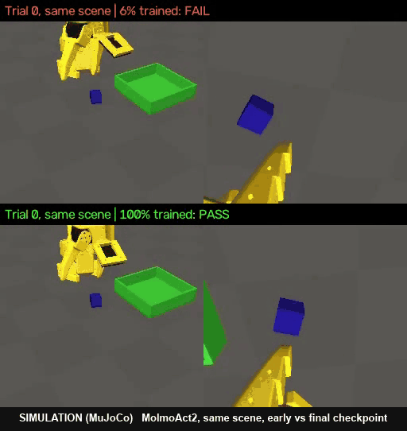

# video2sim-so101

**One short video of a hand moving a cube becomes 1,000 physics-verified robot demos in simulation, which then train three robot policies on a single AMD MI300X (ROCm).** The robot is the LeRobot SO-101 arm. **Every number and clip on this page is from simulation (MuJoCo), not a real robot.**

<p align="center">
  
</p>
<p align="center"><sub><b>Simulation (MuJoCo).</b> Same scene, fine-tuned MolmoAct2. Top: early checkpoint (about 6% of training), fails. Bottom: final checkpoint, passes. Left: front camera; right: wrist camera.</sub></p>

**Headline (simulation):** the fine-tuned 5.4B MolmoAct2 makes a clean, physics-valid pick-and-place on **137 of 200 unseen scenes (68.5%, 95% interval 61.8–74.5%)** and shows no statistically significant drop on any of 9 out-of-range tests.

More clips, all simulation: [same scene, before vs after](docs/media/before_after_trial0.mp4) · [clean pass 1](docs/media/final_trial1.mp4) · [clean pass 2](docs/media/final_trial3.mp4) · [one generated training demo](docs/media/expert_demo_front.mp4)

## What it does

1. **Video to task.** A 3-second stock clip (Pexels) shows a hand moving a sugar cube. `demo/` tracks the **cube**, not the hand: its path through the air, when it was gripped and released, and the pinch width (MediaPipe hands, SAM 2.1, Depth Anything V2).
2. **Task to many scenes.** A scripted expert (inverse kinematics plus servo-speed-capped motion) replays that cube path on a MuJoCo SO-101 under randomised cube pose, size, mass and friction, servo strength, lighting, colours and camera pose.
3. **Physics check.** An episode is kept only if both jaws really carry the cube (no welds, latches or teleporting), nothing collides, and the cube ends at rest in the tray with the gripper open. **1,000 of 1,055 attempts passed (94.8%).**
4. **Train.** The kept episodes become a LeRobot v3 dataset. MolmoAct2 (5.4B) was fine-tuned on it on one MI300X with ROCm; SmolVLA (0.45B) and ACT were trained on the same data for comparison.
5. **Test.** Each policy drives the simulated arm closed-loop on scenes it never saw, plus a 9-rung "out-of-range" ladder (camera pose, exposure, colours, distractor objects). A separate verifier judges every run from physics alone.

## Results (simulation only)

Two pass levels: **L_task** = the cube was carried by both jaws and ends released in the tray. **L_full** = L_task plus every physics-honesty rule (no arm-table or self collision, no drop or slip, release at most 10 mm above the floor, torque and joint limits). k/n with 95% Wilson intervals.

| Model | Size | Training | Test scenes | L_full (clean pass) | L_task (cube in tray) |
|---|---|---|---|---|---|
| MolmoAct2, fine-tuned from `allenai/MolmoAct2-SO100_101` | 5.4B | 23,400 steps, 8 h 52 min, 1× MI300X | 200 held-out | **137/200 = 68.5%** (61.8–74.5) | **158/200 = 79.0%** (72.8–84.1) |
| SmolVLA, from `lerobot/smolvla_base` | 0.45B | 20,000 steps | held-out ids 0–99 | 38/100 (29.1–47.8) | 75/100 (65.7–82.5) |
| ACT (LeRobot) | <0.1B | 30,000 steps | held-out ids 0–99 | 17/100 (10.9–25.5) | 69/100 (59.4–77.2) |

- **Bigger model, cleaner motion.** On the shared scenes MolmoAct2 beats SmolVLA (Holm p = 0.032) and ACT (Holm p = 2.8e-08) on L_full. The small models often get the cube into the tray but break a physics rule; ACT mostly presses into the table after finishing.
- **Out-of-range ladder.** Nine rungs, 50 scenes each: camera height, pitch, yaw, distance and a combined camera shift; exposure; unseen colours; colours plus camera; 1–2 distractor objects. MolmoAct2 shows **no Holm-significant drop** against its own baseline on any rung. With n = 50, small drops would not be visible. The scripted expert scores 17/20 L_full on every rung.
- **The data engine is a lever.** Same ACT recipe, same scenes, trained on data with wider camera and exposure variation. L_full on **unseen colours rose from 2 to 18 of 50**, and on **camera distance from 4 to 20 of 50** (Holm p = 0.027 each). Colours were not widened in training, so the colour gain is the cleaner evidence; the camera-distance rung lies mostly inside the wider training range. **Wide data did not fix distractors:** ACT-wide still drops from 39 to 17 of 50 on L_task (Holm p = 9.3e-05).
- **Laptop-sized memory (emulated).** Under a PyTorch allocator cap: SmolVLA trains at batch 8 under 5.0 GiB and batch 16 under 7.0 GiB; ACT at batch 32 under 5.0 GiB. This emulates a 6 GB / 8 GB card on the MI300X; it is not a real laptop run.
- **Statistics.** Wilson 95% intervals; paired exact McNemar tests on shared scenes; Holm correction across all 204 tests in the scoreboard. A difference is claimed only when Holm p < 0.05; otherwise "not distinguishable".

Full tables, failure breakdowns and every verdict: **[docs/RESULTS.md](docs/RESULTS.md)**.

## What did not work

- **Picking the named cube among three (language).** SmolVLA (reads the instruction) moved the named cube in 9/60 held-out scenes; ACT without language input in 8/60. Not distinguishable. A random pick among three cubes would be right 1 time in 3, but here the main failure was inaction: in about 75% of runs no cube moved at all. 600 demos were not enough to learn this task.
- **A V-JEPA 2 "judge".** The pre-registered video probe scored AUC 0.784 against 0.802 for a single last-frame DINOv2 baseline (it needed +0.02). JEPA lost as specified.
- **Matching the sim arm to a real arm's camera view.** The overlay check reached a mask IoU of 0.49 against a 0.8 pass mark. Inconclusive: the test cannot tell the default joint mapping from a 20° error.
- **The sim-to-real visual gap is large.** In V-JEPA feature space our renders sit about 90 times further from real SO-101 clips than two halves of the real data are from each other.
- **Not run:** any real-robot test; π0.5 (its tokenizer is gated and access was not granted in time); the filtered-BC "practice round" (built and CPU-tested, dropped for time); parallel policy replicas (they hung on this machine, so evals ran one process at a time).

## Built on

This project assembles published work. **The contribution is the physics verification, the evaluation and the AMD/ROCm build, not a new method.**

| Work | What this repo takes from it |
|---|---|
| [R2R2R: Real2Render2Real](https://arxiv.org/abs/2505.09601) (Yu et al., 2025) | One video to many demos; smooth **and** interpolate the tracked object path. R2R2R replays kinematically; this repo simulates contact physics and discards failures. |
| [X-Sim](https://arxiv.org/abs/2505.07096) (Dan et al., 2025) | Follow the object, not the hand. Idea only; no code reused. |
| [Squint](https://arxiv.org/abs/2602.21203) (Almuzairee et al., 2026) | SO-101 randomisation ranges (jaw stiffness, colour and light jitter, camera). |
| [MuJoCo Menagerie](https://github.com/google-deepmind/mujoco_menagerie) `robotstudio_so101` | The SO-101 model (Apache-2.0, vendored in `third_party/`). |
| [LeRobot](https://github.com/huggingface/lerobot) 0.6.1 | Dataset format, training and policy code. |
| [MolmoAct2](https://huggingface.co/allenai/MolmoAct2-SO100_101) (Ai2) | 5.4B base policy, already tuned on SO-100/101 data. |
| [SmolVLA](https://huggingface.co/lerobot/smolvla_base) | 0.45B vision-language-action baseline. |
| ACT (Action Chunking Transformer, via LeRobot) | Small imitation-learning baseline. |

## Repo map

Work happened on parallel branches; until they are merged, this is where each piece lives.

| Branch | What it holds |
|---|---|
| `main` | Video-to-task extractor (`demo/`), demo generator and verifier (`datagen/`), grasp-physics gate and mjlab task (`task/`), Menagerie model, droplet setup (`env/`), design docs |
| `datagen/10hz-variety` | 10 Hz recording, scene variety, MolmoAct2 export and training launcher: produced the 1,000-demo dataset |
| `datagen/wide-camera` | Wider camera and exposure randomisation: the data-engine experiment |
| `eval/harness` | Closed-loop eval harness, phase-free physics verifier, filtered-BC pipeline (built, not run) |
| `eval/ood-ladder` | The 9-rung out-of-range ladder and free-body distractors |
| `small/smolvla-act` | SmolVLA and ACT training, memory-cap emulation, scoreboard generator (`eval/scoreboard.py`) |
| `small/eval-p24` | Small-model eval fixes (camera renaming, SmolVLA action queue) |
| `multitask/scene-v1` | Three-cube, named-target task: expert, verifier rules and eval |
| `jepa/judge` | V-JEPA 2 success probe and realism score (negative result) |
| `calib/so101-units` | Sim-to-LeRobot joint-unit conversion and the real-camera overlay check |
| `v2/object-mesh` | Mesh-to-MuJoCo object converter, validated on YCB scans |
| `droplet/step1-render-smoke` | Render-quality option and the MolmoAct2 smoke script |
| `report/overnight` | Raw run report, ledger and gate files (separate history); summarised in [docs/RESULTS.md](docs/RESULTS.md) |
| `proposal/*` | Design proposals (docs only) |

## Next steps

- **Physics vs kinematic demos.** Train on R2R2R-style kinematic replays of the same scenes and compare with the physics-verified set, to measure what the physics filter is worth.
- **Real-robot test** on an SO-101.
- **A drawer task**, the first step beyond pick-and-place.
- **Phone-scan objects.** `v2/object-mesh` already turns any mesh into a checked MuJoCo object. An image-to-3D system such as NVIDIA's [GATOR](https://arxiv.org/abs/2610.11215) (code not yet released) is the kind of piece that would slot in front of it.
- **LLM agents that write new skill modules** for the scripted expert, each gated by the same physics verifier.

## Quick start on an AMD MI300X droplet

Use AMD Developer Cloud with the "PyTorch 2.10.0 – ROCm 7.2" image.

```bash
git clone https://github.com/Catnip-harvest/video2sim-so101 /root/work/video2sim-so101
bash /root/work/video2sim-so101/env/start_container.sh
docker exec sprint bash /work/video2sim-so101/env/setup_container.sh
docker exec -it sprint hf auth login      # once; your own token, typed by you
cp .env.example .env                      # then edit the repo names
docker exec sprint bash -lc "cd /work/video2sim-so101 && INSTALL_LEROBOT=0 PY=python N=20 SPECS=sugar bash datagen/run_droplet.sh"
```

- **Rendering is CPU-only.** It runs through OSMesa; EGL does not work here.
- **Protect the ROCm build of PyTorch.** Install every Python package with `PIP_CONSTRAINT=env/constraints.txt`, so pip never swaps it for a CUDA build.
- Commands for training, evaluation and each experiment are in the `README_*.md` file on the matching branch.

## Layout of `main`

| Folder or file | What it holds |
|---|---|
| `demo/` | Video to task spec: MediaPipe hand ONNX, SAM 2.1 object track, Depth Anything V2 Small, A4-sheet calibration. `python demo/tools/fetch_models.py` downloads the weights. |
| `datagen/` | Task spec to N physics-verified SO-101 episodes to a LeRobot v3 dataset (`run_droplet.sh`). |
| `task/` | mjlab task `SO101-PickPlace-State` and `tests/test_grasp_physics.py`, the gate that rejects fake grasps. |
| `third_party/menagerie_so101/` | Vendored Menagerie model, Apache-2.0, licence inside. |
| `env/` | Setup for the AMD MI300X droplet. |
| `docs/` | Design (`DESIGN.md`, `FINAL_DESIGN.md`), full results (`RESULTS.md`), media. |
| `CLAUDE.md`, `HANDOFF.md` | Rules and plan given to the coding agent that ran on the droplet. |

## Early checks (laptop, simulation)

| Check | Result |
|---|---|
| Grasp-physics gate | 12 pick cases and a negative control pass; contact force carries 0.293 N against a 0.294 N object weight |
| Generator, 50 episodes per spec | 50/50 accepted (sugar-cube spec), 50/51 (synthetic spec) |
| Ablation: step servo commands | Acceptance drops to 72.5%, mostly dropped cubes, so the verifier does reject failures |
| Task extractor on a synthetic clip with ground truth | Pick position off by 1.5 mm, place position off by 2 cm |

## Limits

- **All results are simulation.** Nothing has been run on a real SO-101.
- **The stock clip has no calibration sheet,** so its scale is uncertain by about ±20%.
- **The demos come from a scripted expert** that follows the video's cube path; they are not retargeted human motion.
- **One task, one object family** (a 20–26 mm cube into an 11 cm tray).

## Licences

- **This repo's code:** MIT, to be confirmed.
- **Menagerie model:** Apache-2.0.
- **Pexels test clip:** Pexels License; source in `demo/third_party/`.
- **Model weights** are not included. They come from their own repositories under their own licences.
